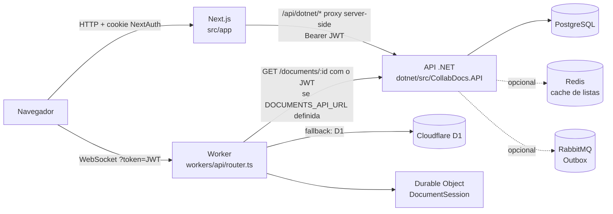

# CollabDocs

Editor de documentos colaborativo com três partes:

- **Frontend** Next.js 14 (App Router + NextAuth com GitHub/Google);
- **API .NET 9** (Clean Architecture + MediatR + EF Core/PostgreSQL), dona dos documentos, colaboradores e da autorização;
- **Cloudflare Worker** (TypeScript + Durable Objects) para WebSocket/presença em tempo real. O Worker também mantém uma API REST própria sobre D1, que o frontend atual **não** usa para CRUD.

## Arquitetura



- O mesmo segredo HS256 (`NEXTAUTH_SECRET`) assina o JWT do NextAuth e é verificado pela API .NET (`Jwt:Secret`) e pelo Worker. Os dois aceitam só `alg: HS256` e exigem `exp`.
- O conteúdo editado é salvo pelo cliente via `PUT /api/documents/{id}` na API .NET. O WebSocket apenas retransmite atualizações entre clientes conectados. O Durable Object não persiste conteúdo.
- Redis e RabbitMQ são opcionais. Sem `ConnectionStrings:Redis` a API usa `NullDocumentCacheService`. Sem `RabbitMQ:Host` as mensagens do outbox ficam no banco.

## Autorização por documento

A regra fica em um só lugar em cada backend:

- .NET: `dotnet/src/CollabDocs.Domain/Authorization/DocumentAccessPolicy.cs`, aplicada por `DocumentAuthorizationService`, que todos os handlers usam.
- Worker: `workers/domain/authorization.ts`, aplicada por `workers/application/access.ts`, `workers/collaboration/access.ts` (upgrade do WS) e `workers/collaboration/messages.ts` (mensagem a mensagem).

| Operação | Sem acesso | Leitor público¹ | Viewer (`read`) | Editor (`write`) | Dono |
|---|---|---|---|---|---|
| Ler documento | 404 | ✔ | ✔ | ✔ | ✔ |
| Listar colaboradores | 404 | lista vazia | ✔ | ✔ | ✔ |
| Editar conteúdo / renomear | 404 | 403 | 403 | ✔ | ✔ |
| Mudar visibilidade | 404 | 403 | 403 | 403 | ✔ |
| Excluir | 404 | 403 | 403 | 403 | ✔ |
| Adicionar/remover colaborador | 404 | 403 | 403 | 403 | ✔ |
| Conectar ao WebSocket | 404 | ✔ | ✔ | ✔ | ✔ |
| Enviar `update` pelo WebSocket | — | descartado | descartado | ✔ | ✔ |

¹ Usuário autenticado, sem vínculo, lendo documento `public`.

Regras adicionais:

- Documentos são **privados por padrão**. Só ficam públicos com `visibility: "public"` explícito.
- Quem não pode ler recebe **404 com o mesmo corpo de um id inexistente**. Assim a resposta não revela se um documento privado existe.
- O colaborador é vinculado pelo **e-mail do JWT**, sem diferenciar maiúsculas. O convite grava `UserId` vazio.
- A permissão `owner` não pode ser concedida pela API (400). Uma linha legada com `owner` vale como editor. Só `Document.OwnerId` exclui, muda a visibilidade e gerencia colaboradores.
- O dono não pode se convidar. Um novo convite para o mesmo e-mail atualiza a permissão.
- No WebSocket, o Worker valida o JWT e resolve o papel **antes** do upgrade. A checagem é fail-closed: erro de rede ou de banco nega o acesso. O Durable Object confia só nos parâmetros `__verified_*` injetados pelo router. Ele também ignora `userId`/`userName` enviados pelo cliente e rejeita tipos de mensagem do servidor (`join`, `leave`).
- A sessão WebSocket tem prazo: o menor entre o `exp` do JWT e 10 minutos. Ao vencer, o Durable Object fecha com o código `4001` e o cliente reconecta, passando de novo pela autorização. Mensagens recebidas após o prazo são descartadas.

Decisões registradas em [`docs/adr/`](docs/adr).

## Como rodar

### Pré-requisitos

- Node.js 20+
- .NET SDK 9
- Docker com Docker Compose, para a stack completa e para os testes de integração

### Local, serviço a serviço

```bash
cp .env.example .env          # preencha NEXTAUTH_SECRET e as credenciais OAuth

# Frontend
npm ci --legacy-peer-deps
npm run dev                   # http://localhost:3000

# Worker (WebSocket)
npx wrangler dev --local --port 8787 \
  --var NEXTAUTH_SECRET:"$NEXTAUTH_SECRET" \
  --var DOCUMENTS_API_URL:http://localhost:5000/api

# API .NET (precisa de PostgreSQL acessível em ConnectionStrings__Default)
cd dotnet
ConnectionStrings__Default="Host=localhost;Database=collabdocs;Username=...;Password=..." \
Jwt__Secret="$NEXTAUTH_SECRET" \
dotnet run --project src/CollabDocs.API   # http://localhost:5000 (Swagger em Development)
```

A API aplica as migrations do EF Core na inicialização (`db.Database.Migrate()` em `Program.cs`).

### Docker Compose

```bash
cp .env.example .env    # troque NEXTAUTH_SECRET, POSTGRES_PASSWORD e RABBITMQ_PASSWORD
docker compose up --build
```

| Serviço | Porta |
|---|---|
| frontend | 3000 |
| worker (wrangler dev) | 8787 |
| dotnet-api | 5000 |
| postgres | 5432 |
| rabbitmq (UI) | 15672 |
| redis | 6379 |

## Variáveis de ambiente

| Variável | Usada por | Descrição |
|---|---|---|
| `NEXTAUTH_SECRET` | Next.js, Worker, API (`Jwt__Secret`) | Segredo HS256 compartilhado |
| `NEXTAUTH_URL` | Next.js | URL pública do frontend |
| `GITHUB_CLIENT_ID` / `GITHUB_CLIENT_SECRET` | Next.js | OAuth GitHub |
| `GOOGLE_CLIENT_ID` / `GOOGLE_CLIENT_SECRET` | Next.js | OAuth Google |
| `DOTNET_API_URL` | Next.js (server-side) | Base da API .NET usada pelo proxy `/api/dotnet` |
| `NEXT_PUBLIC_API_URL` | Next.js (build) | Base REST do Worker |
| `NEXT_PUBLIC_WS_URL` | Next.js (build) | Base do WebSocket do Worker |
| `ALLOWED_ORIGINS` | Worker | Origens CORS, separadas por vírgula |
| `DOCUMENTS_API_URL` | Worker | Base da API .NET para autorizar o WebSocket. Sem ela o Worker consulta o D1 |
| `ConnectionStrings__Default` | API | PostgreSQL (obrigatória) |
| `Jwt__Secret` | API | Igual a `NEXTAUTH_SECRET` (obrigatória) |
| `ConnectionStrings__Redis` | API | Opcional: ativa o cache de listas |
| `RabbitMQ__Host` (+ `Port`, `Username`, `Password`, `ExchangeName`, `QueueName`) | API | Opcional: ativa o publisher do outbox |
| `AllowedOrigins__0..n` | API | CORS |
| `OTEL_EXPORTER_OTLP_ENDPOINT` | API | Opcional: exporta traces e métricas OTLP |
| `POSTGRES_USER` / `POSTGRES_PASSWORD` / `RABBITMQ_USER` / `RABBITMQ_PASSWORD` | docker compose | Credenciais da infra local |

## Testes

```bash
# TypeScript (Vitest): Worker (política, casos de uso, WebSocket) e proxy do Next
npm test

# Typecheck e lint
npm run typecheck && npm run typecheck:workers && npm run lint

# .NET: unitários (inclui a matriz papel x operação)
cd dotnet && dotnet test tests/CollabDocs.Tests.Unit

# .NET: integração HTTP + PostgreSQL real via Testcontainers (precisa de Docker)
cd dotnet && dotnet test tests/CollabDocs.Tests.Integration

# E2E (Playwright) contra um build local
npm run build && npm start & npx playwright test
```

## CI/CD

- `.github/workflows/ci.yml` roda em `pull_request` e em `push` para `main`. Jobs: typecheck, lint, Vitest e build do Next. Depois E2E Playwright, `npm audit` e build mais testes unitários e de integração do .NET.
- `.github/workflows/deploy.yml` (API .NET na AWS Lambda) e `.github/workflows/deploy-worker.yml` (Cloudflare Worker) são **apenas manuais** (`workflow_dispatch`). Nenhum deploy roda em PR.
- O frontend é publicado pela integração Git da Vercel e a API pelo Blueprint do Render (`render.yaml`), ambos fora deste CI.

## Deploy gratuito

Situação verificada em 2026-11-03 com `curl`:

| Parte | URL | Estado |
|---|---|---|
| Frontend (Vercel Hobby) | https://collabdocs-app.vercel.app | 200; login GitHub/Google configurado |
| Worker (Cloudflare free) | https://collab-docs.collabdocs.workers.dev | 200 em `/` e `/api/health` (versão anterior a este PR) |
| API .NET (AWS Lambda) | Function URL antiga | 403 `This account is suspended` |

Sem a API .NET o dashboard não lista nem cria documentos. A troca abaixo usa apenas planos gratuitos:

| Parte | Plataforma | Arquivo |
|---|---|---|
| Frontend Next.js | Vercel (Hobby) | `vercel.json` |
| API .NET | Render (web service free, Docker) | `render.yaml` |
| PostgreSQL | Neon (free) ou Supabase (free) | — |
| WebSocket/presença | Cloudflare Workers (free; Durable Objects SQLite) | `wrangler.toml`, `deploy-worker.yml` |
| Redis / RabbitMQ | desligados (opcionais) | — |

Passo a passo:

1. **Neon:** crie um projeto e copie a connection string (`postgresql://...?sslmode=require`). A API aceita esse formato e aplica as migrations ao subir.
2. **Render:** *New > Blueprint*, aponte para este repositório. Preencha `ConnectionStrings__Default` (URI do Neon) e `Jwt__Secret` (mesmo valor de `NEXTAUTH_SECRET`). Confira `AllowedOrigins__0`. A URL fica `https://<nome-do-serviço>.onrender.com`. Teste `GET /health`.
3. **Vercel:** em *Settings > Environment Variables*, defina `DOTNET_API_URL=https://<serviço>.onrender.com/api` (o `vercel.json` não aponta mais para a Lambda), além de `NEXTAUTH_SECRET`, `NEXTAUTH_URL` e as credenciais OAuth. Faça um redeploy.
4. **Worker:** `npx wrangler secret put NEXTAUTH_SECRET` uma vez. No GitHub, crie os secrets `CLOUDFLARE_API_TOKEN` e `CLOUDFLARE_ACCOUNT_ID` e as variáveis `DOCUMENTS_API_URL` (`https://<serviço>.onrender.com/api`) e `ALLOWED_ORIGINS`. Rode *Actions > Deploy Worker (Cloudflare)*.

Limites do plano free que afetam a demo:

- O Render adormece o serviço após ~15 min sem tráfego. A primeira chamada depois disso pode levar dezenas de segundos. O proxy da Vercel tem `maxDuration: 60`.
- O Neon suspende o banco ocioso. A primeira consulta paga um atraso extra.
- As filas de e-mail do Worker exigem plano pago e seguem desativadas.

A pasta `aws/` e o `deploy.yml` descrevem a infraestrutura paga anterior (ECS/Lambda). Ficam como referência e não rodam sozinhos.

## Limitações conhecidas

- **Revogação no tempo real não é instantânea:** o papel é resolvido no upgrade e reavaliado a cada reconexão. Um colaborador removido (ou um documento que ficou privado) perde o WebSocket em até 10 minutos. Na API REST a revogação vale na requisição seguinte.
- **`middleware.ts` na raiz não é carregado pelo Next.js**, porque o app fica em `src/` (o build gera `middleware-manifest.json` vazio). As páginas checam a sessão no cliente. Os dados ficam protegidos pela API .NET, que valida o JWT em toda requisição. Ativar o middleware (mover para `src/`) exige revisar o `matcher`, porque hoje ele bloquearia `/` e `/document/demo`, usados pelos testes E2E.
- **Sem `DOCUMENTS_API_URL` o tempo real não autoriza documentos da API .NET.** O fallback lê o D1 do Worker, que não recebe esses documentos. O resultado é 404 no upgrade.
- O JWT vai na query string do WebSocket (`?token=`), porque o navegador não permite cabeçalho no upgrade. O router não loga a query, mas proxies intermediários podem logar.
- **O e-mail do JWT é a identidade do colaborador.** A API confia no e-mail emitido pelo NextAuth/provedor OAuth e não faz verificação própria.
- O WebSocket não tem resolução de conflitos (CRDT/OT): vale a última atualização recebida. A persistência continua com versão otimista (`expectedVersion`, 409).
- O cache Redis de listas usa TTL de 5 min. Revogações invalidam todas as listas (contador de geração). Uma escrita concorrente durante a invalidação pode regravar uma lista antiga até o TTL.
- O Worker mantém uma API REST de documentos sobre D1 com a mesma política, mas o frontend atual não a usa.
- As filas de e-mail (Cloudflare Queues) estão desativadas em `workers/index.ts`.
- O `HEALTHCHECK` do Dockerfile da API usa `wget`, que não existe na imagem `aspnet`. O compose desativa esse healthcheck.
